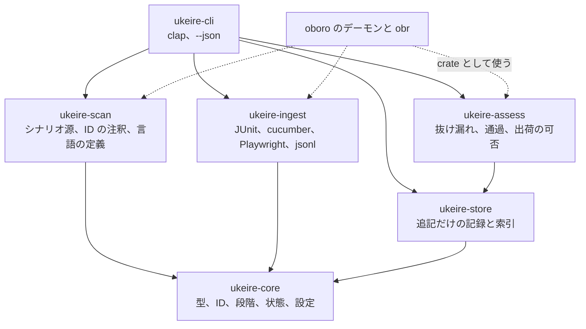

# oboro-ukeire 設計

受け入れ項目 (シナリオ) と試験の結果を結び付けて記録し、マージと出荷の判断の根拠を出す Rust のライブラリと CLI。oboro が crate として取り込み、1 つの実行ファイルに入れる。単体の CLI としても使える。

手本は Go 版 `oboro-app/oboro-ukeire-go` (非公開)。データの形と規則と試験の材料を写し、出力が一致することを試験で示す。Go 版のハーネス (`.claude/`、`AGENTS.md`、`scripts/` など) は写さない。

## 方針

| 項目 | 決まり |
|---|---|
| 言語 | Rust (edition 2024、Cargo workspace)。設定は oboro-ja に揃える |
| 対象の repo | 言語を問わない。言語ごとの違いはコードでなくデータ (言語の定義) に置く |
| 試験の実行 | しない。結果のファイルを取り込むだけ |
| 出力 | 人間向けの表示と `--json` の 2 つ。JSON の形は `docs/schema/` の JSON Schema が正本 |
| 画面 | 持たない。Go 版の HTTP、SSE、Web ビューアは移さず、oboro の画面が受け持つ |
| ライセンス | MIT OR Apache-2.0 |

## 構成



| crate | Go 版の対応 | 中身 |
|---|---|---|
| `ukeire-core` | `model`、`config` | ID、段階 (planning ... accepted)、状態、観点、結果、紐付けの型。設定 `ukeire.toml` の読み込み |
| `ukeire-scan` | `scan`、`gherkin`、`declare` | シナリオ源、試験の中の ID の注釈、言語の定義 |
| `ukeire-ingest` | `ingest`、`bddresult` | 試験の結果のファイルを `Result` へ変換 |
| `ukeire-store` | `store`、`vcs` | `acceptance.jsonl`、`results.jsonl`、`bindings.json`、`features.json` の読み書き。コミットで引ける |
| `ukeire-assess` | `check`、`assess`、`report`、`export` | PR の受け入れ確認、集計、出荷の可否と根拠 |
| `ukeire-cli` | `cmd/ukeire` | `init`、`scan`、`ingest`、`manual`、`check`、`status`、`export` |

Go 版の `proposal` (AI の提案) は第 2 段階で移す。`server`、`webui`、`uikit`、`backend/`、`frontend/`、`infra/` は移さない。

## 多言語への対応

対象の repo の言語を増やすとき、コードを足さずに済む形にする。違いは 3 か所にだけ現れる。

| 違いの場所 | 置き方 |
|---|---|
| 試験の書き方 (試験の宣言、コメント記号) | 言語の定義 (データ)。組み込みで持ち、`ukeire.toml` で足せる |
| 結果のファイルの形 | 言語に依らない形を正本にする。言語の固有の形は取り込み口を 1 つ足す |
| シナリオのキーワードの言語 | Gherkin の `# language: ja` に従う |

### 言語の定義

Go 版は `testNameRe`、`goTestRe`、`pyTestRe` と `DetectFramework` の分岐に言語を埋め込んでいる。Rust 版はこれを次の形のデータにする。

```toml
# 組み込みの定義と同じ形。ukeire.toml の [[language]] で足すか上書きする
[[language]]
name = "rust"
extensions = ["rs"]
line_comment = ["//"]
block_comment = [["/*", "*/"]]
# 試験の宣言。最初の捕獲が試験の名前
test_patterns = ['fn\s+(\w+)\s*\(']
# 宣言の前に付く属性や修飾の行 (ID の注釈と宣言の間に挟まってよい)
decorator_patterns = ['^\s*#\[']
framework = "cargo"
```

| 組み込み | 拡張子 | 試験の宣言 | framework |
|---|---|---|---|
| rust | `rs` | `#[test]` などの後の `fn name` | cargo |
| typescript / javascript | `ts` `tsx` `js` `jsx` `mjs` `cjs` | `test(`、`it(`、`describe(`、`test.prop(...)(` の第 1 引数 | vitest、jest、playwright (内容で判定) |
| go | `go` | `func TestXxx(` | go |
| python | `py` | `def test_xxx(` | pytest |
| gherkin | `feature` | `Scenario:`、`Scenario Outline:` (各言語のキーワード) | cucumber |

ID の注釈の読み方 (注釈と宣言の距離、複数の ID、接頭辞) は言語に依らない共通の規則にし、Go 版の `testdata/conventions` で振る舞いを固定する。

### 結果の取り込み

| 形 | 主な出し手 | 扱い |
|---|---|---|
| ukeire の jsonl | どの言語でも書ける | 正本の形。`docs/schema/result.schema.json` を公開する |
| JUnit XML | cargo-nextest、Vitest、Jest、pytest、go-junit-report、Gradle など | 言語に依らない口として第一に支える |
| cucumber JSON | cucumber 系 | Go 版と同じ |
| Playwright JSON | Playwright | Go 版と同じ (再試行と flaky の判定を含む) |

`cargo test` の JSON 出力は安定版で使えないので、Rust の試験は cargo-nextest の JUnit を正の口にする。`go test -json` と Vitest の JSON は需要が出たら取り込み口を足す。

### シナリオ源

`ScenarioSource` を trait にし、実装を 2 つ持つ。

| 実装 | 中身 | 段階 |
|---|---|---|
| `.feature` | Go 版と同じ。`@acceptance:<ID>` のタグ | 第 1 段階 (Go 版との一致を示す) |
| Markdown の中の Gherkin | oboro の `docs/scenarios/` の形 (コードブロックの Gherkin と S-ID) | 第 1 段階で読めるところまで。正本にするかは oboro 側で決める |

## データ

形は Go 版の README「データ形式」と同じにし、Go 版の出力をそのまま読めることを保つ。置き場は既定で repo の `ukeire/`。oboro に組み込んだ時の置き場は oboro 側で決める。

## 試験

| 種類 | 中身 |
|---|---|
| Go 版との一致 | Go 版の `testdata/` を写し、Go 版の CLI で作った期待の JSON と Rust 版の出力を比べる。期待の JSON は `tests/golden/` に置き、作り直す手順を `docs/` に残す |
| 言語の定義 | 組み込みの言語ごとに、ID の注釈と試験の宣言の材料を置いて紐付けを確かめる |
| 取り込み | 形ごとに材料を置き、状態、時間、再試行の写しを確かめる |
| 品質の関門 | `cargo fmt --all --check`、`cargo clippy --workspace --all-targets -- -D warnings`、`cargo test --workspace` |

## 段階

| 段階 | 中身 |
|---|---|
| 1 | workspace、言語の定義、走査、取り込み (4 形)、記録、判定、CLI (`--json`)。Go 版との一致 |
| 2 | AI の提案 (`proposal`)、`go test -json` などの取り込み口 |
| 3 | oboro への組み込み (デーモンの自動の取り込み、`obr accept`、関門、画面)。oboro の Issue で進める |
